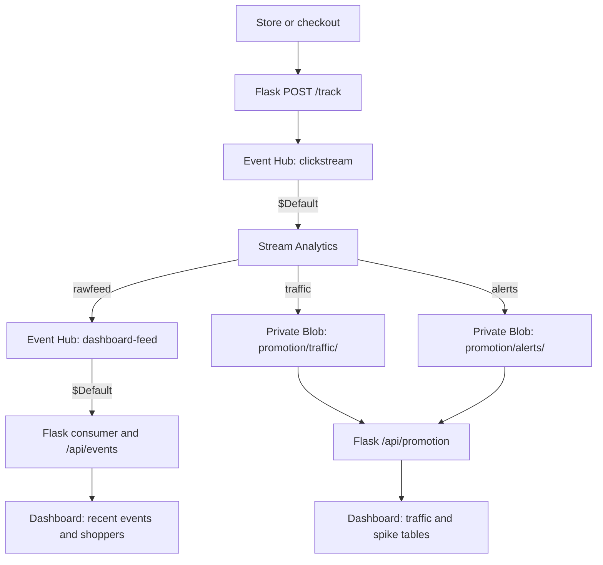

# ShopStream promotion analytics | CST8916 Assignment 2

**Unlisted demonstration video:** [Insert your verified YouTube URL here before submission.]

The Week 10 Flask store sends shopping events to Azure Event Hubs. One Stream Analytics job produces per-device traffic counts, store-wide click alerts and a copy of the original stream for the Week 10 shopper dashboard.

## Architecture



## Design decisions

Flask classifies the HTTP User-Agent on every accepted /track request, immediately after normalizing the event and before publishing. This single path covers product views, checkout and purchase. Parsing gives deviceType, browser family and OS family without saving the raw header. Missing details become unknown. The values describe the browser’s reported identity and can change with emulation. Flask assigns the event time.

Traffic uses a 10-second tumbling window, grouped by deviceType, over every event. The spike query filters product_click, combines all shoppers and devices, and uses a sliding 10-second window with a count threshold of three. A qualifying sliding window can produce further rows as the click count changes. Both calculations use the server’s event timestamp.

Basic Event Hubs provides a single consumer group per hub. Stream Analytics reads clickstream, while Flask reads the separate dashboard-feed hub. The producer still targets clickstream. Private Blob output makes it possible to inspect the exact row behind a dashboard result. The dashboard polls Flask every ten seconds. Flask reads line-separated JSON from the two dedicated prefixes and returns the newest 30 rows per view. Reading the small demonstration container on refresh is suitable for a short lab run. Blob batching can delay both views.

## Reproduce the deployment

1. Extract the ZIP. Create an **empty private** GitHub repository in your account. From the extracted folder containing app.py, run the commands below in PowerShell. Replace the URL with your own repository URL.

   ```powershell
   git init -b main
   git add .
   git commit -m "Implement ShopStream promotion analytics"
   git remote add origin https://github.com/YOUR-USERNAME/CST8916-Assignment2.git
   git push -u origin main
   ```

2. In an active Azure for Students subscription, create a dedicated resource group. In the same region create a Basic Event Hubs namespace with two hubs, clickstream and dashboard-feed. Use one partition per hub for this small demo. Both use the built-in $Default group. Create a namespace shared access policy for Flask with Send and Listen, and copy the namespace connection string into the server setting below. Keep credentials out of Git and the recording.
3. Create a general-purpose v2 storage account and a private container named promotion. Copy the storage account connection string into the Flask server setting. Create one Stream Analytics job with compatibility level 1.2. Add a JSON stream input with alias clickstream, selecting the clickstream hub and $Default. Use an Event Hubs policy with Listen permission.
4. Add the following three job outputs. For Blob, select the storage account and container, use account-key authentication, JSON, UTF-8, line-separated format, and separate path patterns. For faster demonstration, use the smallest supported batch wait and row thresholds. For the rawfeed Event Hub output select JSON, UTF-8, line-separated format and a policy with Send permission. Test the connections.

   | Alias | Destination | Path pattern or hub |
   | --- | --- | --- |
   | traffic | Blob container promotion | traffic/{date}/{time} |
   | alerts | Blob container promotion | alerts/{date}/{time} |
   | rawfeed | Event Hubs | dashboard-feed |

5. Paste all of analytics.sql into the job’s Query editor and save. With the job stopped, select clickstream, upload sample/shopstream-promotion.json as sample input, and select **Test query**. Inspect traffic and alerts separately. Capture the sample evidence before starting the job.
6. Create a Linux Python 3.11 App Service in the dedicated group, using one instance. Under **Settings → Environment variables**, add the values below. Apply changes. Use one Gunicorn worker to keep the Week 10 in-memory feed consistent. Set the startup command to `gunicorn --bind 0.0.0.0:8000 --workers 1 --threads 4 app:app`.

   | App setting | Value |
   | --- | --- |
   | EVENT_HUB_CONNECTION_STR | Your namespace-level Flask policy connection string |
   | EVENT_HUB_NAME | clickstream |
   | EVENT_HUB_CONSUMER_NAME | dashboard-feed |
   | ANALYTICS_STORAGE_CONNECTION_STRING | Your storage account connection string |
   | ANALYTICS_CONTAINER | promotion |
   | SCM_DO_BUILD_DURING_DEPLOYMENT | true |

7. In App Service **Deployment Center**, choose GitHub, authorize your account, select your private repository and main branch, and save. Wait for GitHub Actions to finish. Open the App Service URL and /dashboard in separate tabs. In Stream Analytics select **Start → Now** and wait for **Running**.
8. Open a product on desktop. In Chrome DevTools select a named mobile device in the device toolbar, reload the store, and open a product. Open details at least three times in under ten seconds. Add an item, start checkout and complete a purchase. Inspect the clickstream input’s live data preview in the job editor. Confirm deviceType, browser, os, event_id, event_type and timestamp on the received records. The Week 10 recent feed should also update.
9. Wait for delivery. In the dashboard check UTC window ends, device counts and recent spikes. Open a Blob under promotion/alerts and match its alert_time and click_count to one live dashboard row. If raw events arrive but tables are empty, check job status, input/output event metrics, Blob paths and batch timing. If the page reports a refresh failure, check the App Service storage settings.

## Recording check

| UTC window end | Desktop | Mobile |
| --- | ---: | ---: |
| 09:00:10 | 2 | 2 |
| 09:00:20 | 1 | 1 |
| 09:00:30 | 0 | 1 |

The final window has no desktop output row. Events e03 (mobile at :08), e04 (desktop at :09), and e05 (mobile at :12) span four seconds. They fall into two fixed reporting windows, but all three fit in the rolling ten seconds ending at **09:00:12 UTC**. This produces the first alert with **3 clicks**. The :16 cart event counts toward desktop traffic only. At :24 the earlier clicks have aged out, so that product click generates no alert.

## Demonstration and submission

Record up to five minutes with credentials hidden. Capture the stopped-job sample test first. In the final video show the deployed store URL, activity on both devices, enriched Event Hub input, the SAQL and both sample outputs, and both live dashboard views updating. Show the matching alert Blob row and its UTC time and count. Upload the video as **unlisted**, replace the placeholder above, push the README update and verify playback in a signed-out window.

Invite **ramymohamed10** under repository Settings → Collaborators and verify access by marking time. Submit the **private repository URL** on Brightspace by its posted deadline. After verifying your recording, stop the job and delete the dedicated assignment resource group.

Based on the [Week 10 ShopStream lab](https://github.com/ramymohamed10/26F_CST8916_Week10-Event-Hubs-Lab) and the [assignment brief and recording](https://github.com/ramymohamed10/26F_CST8916_Assignment2). AI assistance was used for the assignment changes and documentation.
